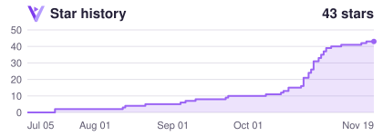
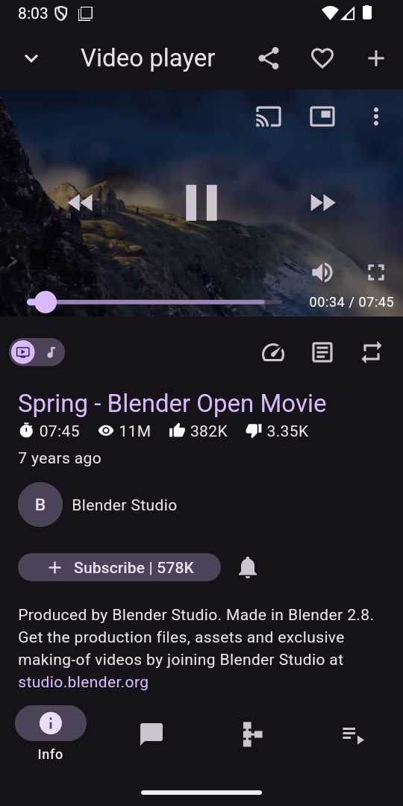
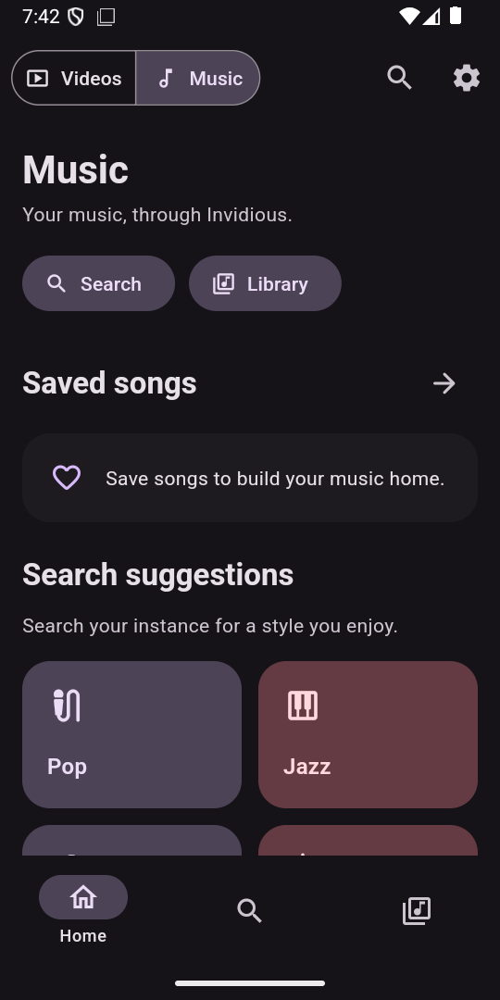
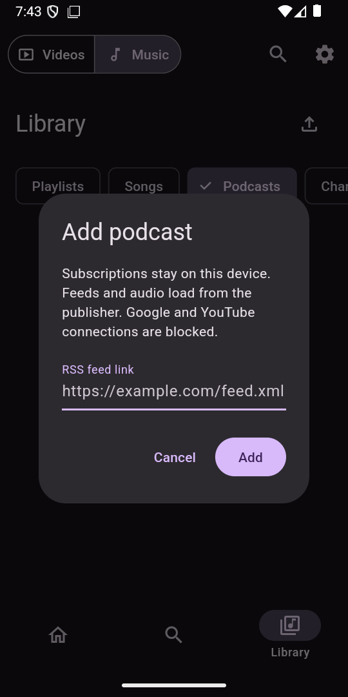
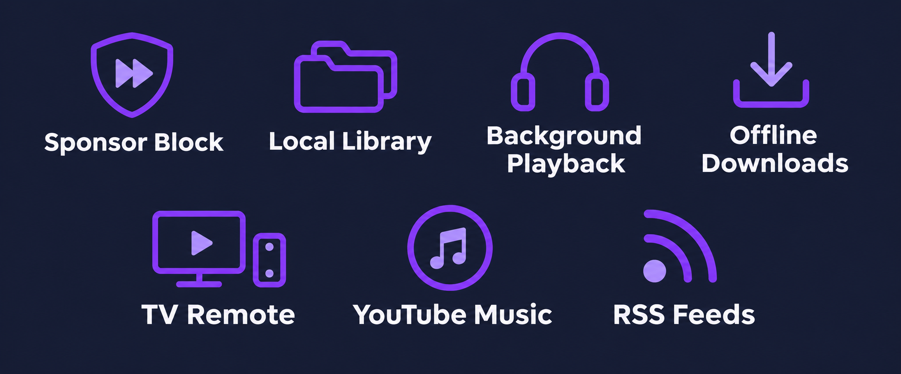

# Videre

 **I wanted Invidious’s privacy-first approach on Android phones, tablets, and TVs. With Videre, I aim to keep you in control of your server, your connection, and your library.**

Watch, listen, and download through a public Invidious instance or your own server, which retrieves YouTube content for you. No Google account is required, and Invidious accounts are optional. [About Invidious](https://invidious.io)

Come talk about Videre, ask questions, and share ideas in our [Matrix chat](https://matrix.to/#/#Videre:matrix.org).

**[Download the latest APK](https://github.com/DVBeckwitt/Videre/releases/latest)** · Android 7.0+ · [Report a bug](https://github.com/DVBeckwitt/Videre/issues)

| YouTube video playback | YouTube Music through Invidious | RSS feeds |
|:---:|:---:|:---:|
|  |  |  |

Captured from Videre 1.22.46 on Android. The player shows *Spring* © Blender Foundation, [CC BY 4.0](https://creativecommons.org/licenses/by/4.0/). [Film credits](https://studio.blender.org/projects/spring/pages/about/) · [Screenshot details](./docs/store-artwork.md#readme-figures)

## Features

- **Sponsor Block.** Skip community-marked sponsor segments automatically.
- **Local Library.** Keep subscriptions, Watch Later, playlists, and history on your device, with separate profiles for each person. [Library and profiles](./docs/profiles-and-authentication.md)
- **Background Playback.** Keep listening with background audio, picture-in-picture, and a sleep timer.
- **Offline Downloads.** Save videos, audio, and playlists on phones and tablets, with quality choices, pause, resume, retry, and Wi-Fi-only transfers.
- **TV Remote.** Send the current video and position to Videre on your TV over trusted Wi-Fi, then control play/pause from your phone.
- **YouTube Music.** Find music from YouTube through your chosen Invidious instance, save songs, build playlists, and use the dedicated audio player. Import songs from a local Google Takeout file. [Music guide](./docs/music.md)
- **Community AI filters.** Optionally label or hide channels listed by AiSList, with separate rules for block entries, warnings, and Music. [Filter coverage and sources](./docs/music.md#home-and-search)
- **RSS Feeds.** Add publisher podcast feeds, listen in the background, save episodes offline, and pick up where you left off. [Podcast guide](./docs/podcasts.md)

## Start watching

1. Download `app-release.apk` from GitHub Releases and allow installation if Android asks. One APK supports phones, tablets, and TVs.
2. Choose **Public instances** or enter your server address, then select **Test and add server**.
3. Find videos, follow channels, and save to Watch Later.

Add or switch instances in **Settings → Manage servers**. Saved logins stay with their original instance. Open **Profiles** from Home or Settings to manage people. Profiles organize a shared device without a PIN.

When your instance offers multiple backends and automatic fallback is enabled, Videre tries your selected backend first. For an eligible playback or download failure, it can try up to two alternatives on the same account. It favors backends that worked recently and temporarily skips ones that reported they were blocked or still starting. It learns from ordinary requests and respects the server’s retry deadline. **Connection help** checks the video API and offers retry, instance switching, or a link to the instance’s video page.

Videre suggests F5 and NerdVPN. These are dated checks, and availability can change.

| Instance | Last recorded check |
|---|---|
| [F5](https://invidious.f5.si) | October 9, 2026 — search, video data, and a media sample passed. Full Android playback remains unverified. |
| [NerdVPN](https://invidious.nerdvpn.de) | November 10, 2026 — Android emulator checks covered video and Music playback, captions, background controls, and downloaded audio. An API key is required. [Coverage and limits](./docs/verification/nerdvpn-default-privacy.md) |

Nadeko is excluded from suggestions while its operator disables third-party API access. Existing saved entries remain available. [Verification](./docs/verification/issue-38-nadeko.md)

To run your own instance, follow the [Invidious installation guide](https://docs.invidious.io/installation/).

## Your connection and privacy

Your instance operator affects privacy and reliability. YouTube video, audio, downloads, and artwork use the selected Invidious proxy. Music browsing uses that instance too. If it cannot proxy a stream, playback fails. Sharing offers your selected instance link or a YouTube link, with an optional playback timestamp. Choosing a YouTube share link only constructs the address; Videre does not connect to YouTube.

SponsorBlock, Return YouTube Dislike, and DeArrow contact their own services. Podcast feeds and audio come from publishers through your configured proxy. Local and server libraries remain separate. [Privacy policy](./docs/privacy.html)

For Orbot, open **Settings → Network proxy → Use Orbot preset** and start Orbot’s SOCKS listener. The editable preset is `127.0.0.1:9050`. Applying a connection change stops playback and pauses downloads. An enabled proxy must be available for internet requests to work. [SOCKS5 setup](./docs/socks-proxy.md)

Protected HTTPS servers support gateway sign-in with Android WebView isolated-profile support. NerdVPN offers external browser sign-in when Videre’s proxy is off, plus in-app sign-in and manual API keys. Settings shows API eligibility. The external browser uses its own network settings. Onion access requires SOCKS/Orbot setup and a key for that exact server address. [Sign-in and API-key guide](./docs/profiles-and-authentication.md)

## Useful tips

- **YouTube link defaults.** In Android's **Settings → Apps → Videre → Open by default**, enable opening supported links and select the YouTube domains, including `youtu.be` and `music.youtube.com`. This is an Android app default; there is no separate Videre toggle. Android 12 and later require this choice for automatic opening from other apps. If an address is unavailable, turn off supported-link handling for the app that currently owns it first. Another app's **Share → Videre** action also accepts links. Incoming links and timestamps are interpreted locally; content and playback requests use your selected Invidious instance. Shared or pasted content links from that instance also open inside Videre.
- **Paste a link into Search.** A watch, channel, or playlist link from a saved Invidious instance opens through your current server. Use Music Search to open a song or artist in Music. For an unfamiliar site with a recognizable content ID, you can choose **Open on current instance**.
- **Player.** Pull down from the description or comments to minimize. Press Home for picture-in-picture where supported. Closing that window keeps audio playing, which you can stop from the notification.
- **Quality and queue.** Set remembered quality and **Autoplay next in queue** in **Settings → Video player**. Adaptive quality sets a maximum and may drop with bandwidth.
- **Downloads.** Under **Settings → Download folders**, set locations for new video and audio downloads independently. Video defaults to app storage. On Android 10 and later, Music downloads default to **Music/Videre**. Choose MP3, Opus, or M4A (AAC) under **Settings → YT Music**. Reopen Videre to recover interrupted transfers. Deleting a download removes its saved file. A copy made with **Export a copy of this song** stays in the destination folder. Reconnect removable storage before retrying.
- **Navigation.** Use the home pencil button or **Settings → Browsing → Customize app sections** to reorder tabs and icons, hide sections, and choose a startup tab.
- **Watch Later and playlists.** Choose **Add to playlist → Watch Later** from a video’s menu. Signed-in users can use **Save a copy on server** after a playlist fully loads.
- **History.** **Video history** and **Music history** track playback separately on this device. **All history on this device** includes older entries. **All history on your server** shows the selected account’s combined history.
- **TV remote.** Select **Receive from phone** on TV, then enter its IP, port, and six-digit code under **Send to TV / remote control** on your phone. Pairing uses unencrypted local HTTP.
- **Backups.** Use **Export backup** or **Restore or import subscriptions** in Settings. Review the preview before merging or replacing, then reopen Videre. Credentials, downloaded files, and podcast subscriptions and progress are excluded.

## Updates and contributing

Update through GitHub Releases or add this repository to Obtainium. APK updates require the same signing key. This README describes current source, so check release notes for your APK’s features. [Release notes](https://github.com/DVBeckwitt/Videre/releases)

Videre and Clipious install separately. Set up Videre before removing Clipious, since Android does not transfer their data and Videre cannot directly import Clipious app storage.

Thanks to weidenwiesel at NerdVPN for bouncing ideas around with me and for running a public Invidious instance that Videre users can connect to over HTTPS with an API key. [NerdVPN](https://nerdvpn.de/) · [weidenwiesel on GitHub](https://github.com/Sommerwiesel)

Send bugs and ideas through **Settings → Bugs and suggestions** in supported builds, or through GitHub Issues. The in-app form works without a GitHub account. Screenshots and diagnostics are optional and off by default. Review the public report before sending. [GitHub Issues](https://github.com/DVBeckwitt/Videre/issues)

In-app submission requires a configured feedback relay. Builds without one can save drafts. Translations live in `lib/l10n/*.arb`. Keep pull requests focused, reuse existing code, and remove obsolete alternatives. [Feedback service setup](./services/feedback/README.md)

## Credits and license

Videre is an independently maintained Clipious fork. The name means “to watch,” a nod to Invidious’s Latin roots. [Clipious](https://github.com/lamarios/clipious)

Original Clipious code © 2023 Paul Fauchon and contributors. Videre modifications © 2026 DVBeckwitt and Videre contributors.

Video interactions and local recommendation algorithms include code ported from
[Flow](https://github.com/Flow-Tube/Flow). Music interactions include code translated
from [Muzza](https://github.com/Maloy-Android/Muzza). Pinned revisions, source files
and adaptations are recorded in the [Flow source ledger](./docs/flow-video-ui-sources.md),
[Music source ledger](./docs/music-ui-sources.md) and
[algorithm attribution](./packages/videre_recommendations/ATTRIBUTION.md).
Their GPL v3 notices are included in **Settings → About → Licenses**.

Licensed under the GNU Affero General Public License v3.0 or later, without warranty. Videre is unaffiliated with Google, YouTube, Invidious, or the original Clipious maintainers. Users are responsible for applicable laws and terms. [License](./LICENSE)
