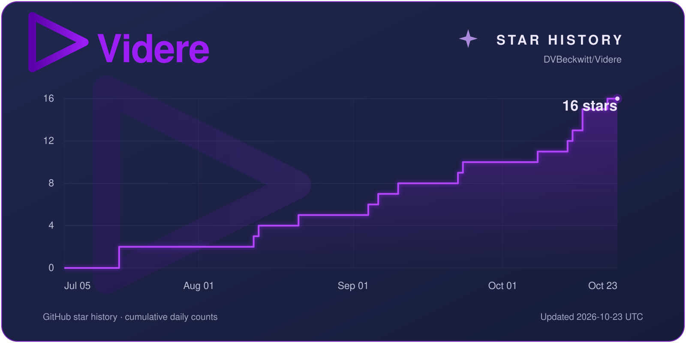
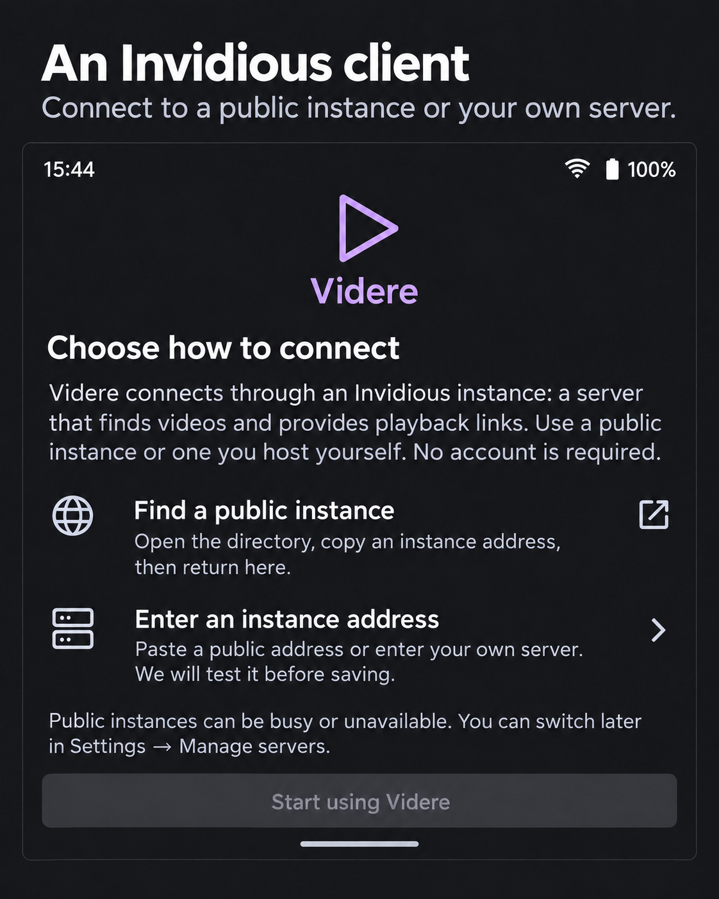
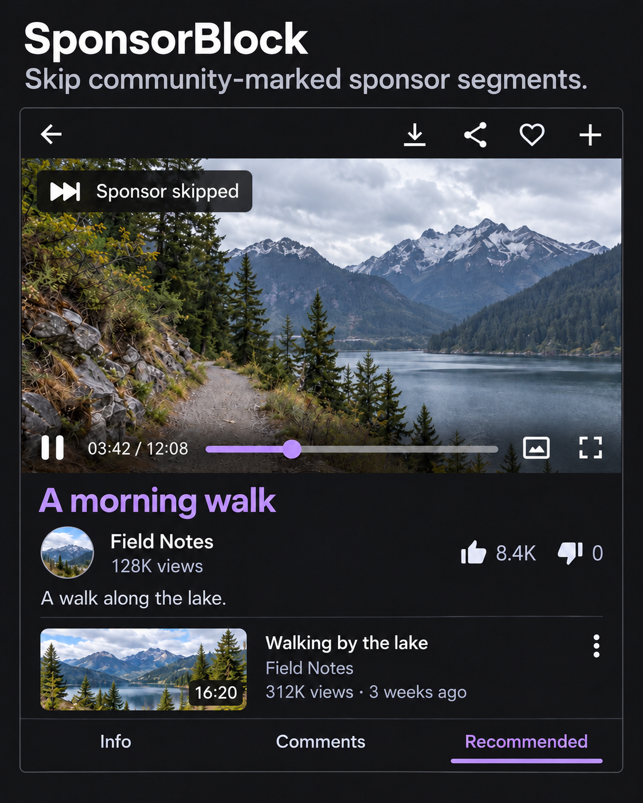
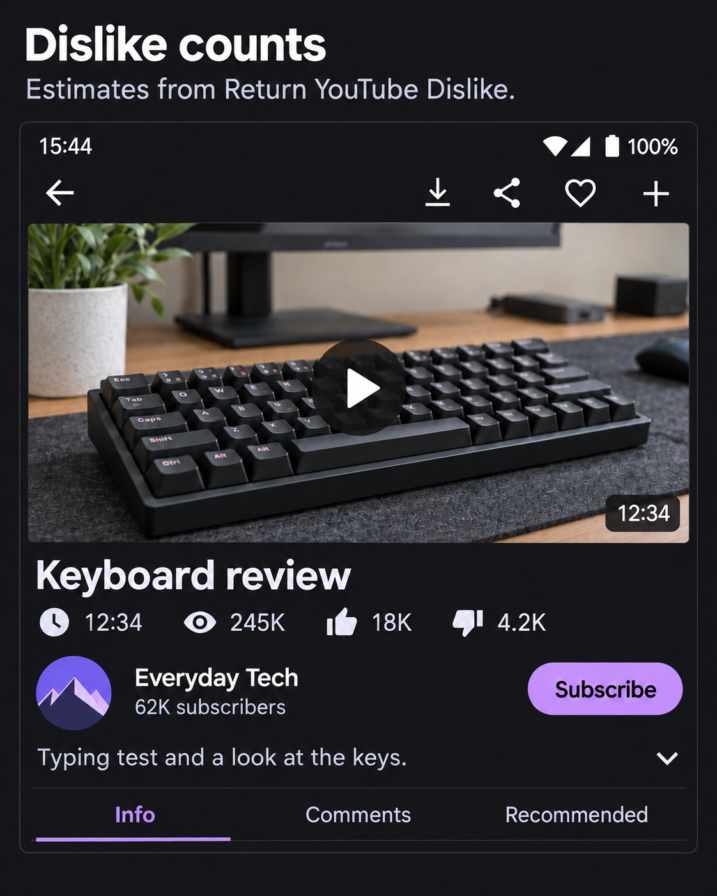
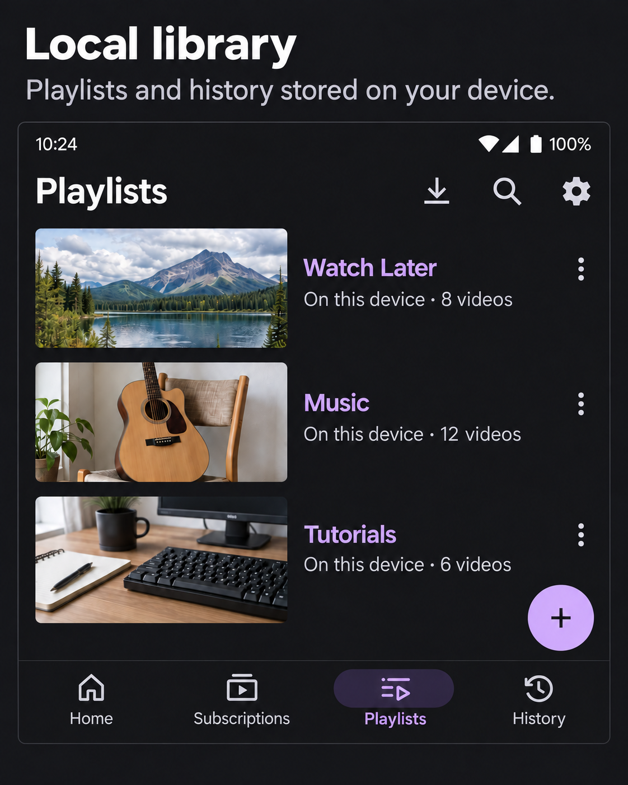
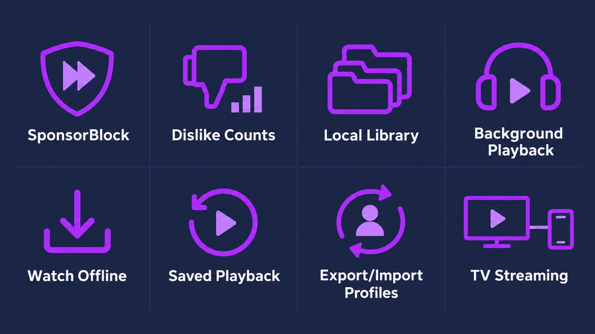

# Videre

[](./docs/star-history.md)

**An open-source [Invidious](https://invidious.io) client for Android phones, tablets, and TVs.**

Watch, listen, and download through a public Invidious instance or your own server. No Google account required; Invidious accounts are optional.

**[Download the latest APK](https://github.com/DVBeckwitt/Videre/releases/latest)** · Android 7.0+ · [Report a bug](https://github.com/DVBeckwitt/Videre/issues)

[](https://github.com/DVBeckwitt/Videre/actions/workflows/build.yml)
[](./LICENSE)

<p>
  <a href="./screenshots/videre-invidious.png"></a>
  <a href="./screenshots/videre-sponsorblock.png"></a>
  <a href="./screenshots/videre-dislikes.png"></a>
  <a href="./screenshots/videre-private-library.png"></a>
</p>

## Features



- **SponsorBlock.** Skip community-marked sponsor segments by default.
- **Dislike Counts.** Estimates from Return YouTube Dislike, enabled by default.
- **Local Library.** Save subscriptions, Watch Later, playlists, and history on your device without an account.
- **Background Playback.** Background and audio-only listening, picture-in-picture, live streams, and a sleep timer.
- **Watch Offline.** Video, audio, and playlist downloads on phones and tablets, with pause, resume, retry, and Wi-Fi-only mode.
- **Saved Playback.** Resume unfinished videos on phone or TV and restore your saved queue.
- **Export/Import Profiles.** Back up and restore your local library and preferences as JSON, or import NewPipe subscriptions.
- **TV Streaming.** Pair Videre on your phone and TV over Wi-Fi. Send the current video and position, then control play/pause from your phone.

Also included: searchable transcripts with seek and copy, subtitles, video filters, and DeArrow.

## Start watching

1. **Install.** Download `app-release.apk` from [GitHub Releases](https://github.com/DVBeckwitt/Videre/releases/latest) and allow installation if Android asks. One APK supports phones, tablets, and TVs.
2. **Add a server.** On the Add server screen, choose **Public instances** or enter your own server address. Select **Test and add server**.
3. **Watch.** Find videos, follow channels, or save to Watch Later. No account required.

Add more addresses in **Settings → Manage servers → Add server**. Switch with **Use this server**; saved addresses and per-server logins are retained. Accounts stay with their original instance.

For playback problems, **Connection help** checks the video API and lets you switch instances or open the video in a browser.

This README describes the current source. Check release notes for your APK's features.

## Public instances

Suggested hosts from the [official Invidious directory](https://docs.invidious.io/instances/), with the last check date shown for each host:

| Public host | Browser | Videre | Last checked |
|---|---|---|---|
| [invidious.f5.si](https://invidious.f5.si) | ✅ Working | ✅ Working* | 9 October 2026 |
| [inv.nadeko.net](https://inv.nadeko.net) | ✅ Working | ✅ Working* | 9 October 2026 |
| [invidious.nerdvpn.de](https://invidious.nerdvpn.de) | ✅ Working | ✅ Working* | 22 October 2026 |

Choose a host in **Settings → Manage servers → Add server → Public instances**, or enter your own address. Videre tests it before saving.

\* Source checks cover search, video data, and a media sample. NerdVPN also passed server stats, direct audio, and instance-proxied video sample checks. Full Android playback is unverified; availability may change.

For self-hosting, see the [Invidious project](https://github.com/iv-org/invidious) and [installation guide](https://docs.invidious.io/installation/).

## Useful tips

**Player controls.** On phones, pull down from the top of the description or comments to minimize the player. Press Home for picture-in-picture where supported and enabled in Android settings. Closing that window keeps audio playing; use the notification to pause or stop.

**SOCKS5 / Orbot.** Open **Settings → Network proxy**, select **Use Orbot preset**, and start Orbot with its SOCKS listener enabled. The editable preset is `127.0.0.1:9050`; Orbot VPN mode is not required. Save proxy settings before adding your first server; once a server is selected, use **Test connection**. Applying a change stops playback and pauses unfinished downloads; resume them afterward. Saving unchanged settings does not interrupt them. Internet requests fail when the enabled proxy is unavailable. Browser sign-in uses the browser's connection, and phone/TV remote control stays on the LAN. Native and full-app Orbot playback have been checked on a Pixel 8 Pro; public-instance video availability remains separate. See [coverage and verification limits](./docs/socks-proxy.md).

**Backups.** In Settings, use **Export backup** to save your local library, filters, and preferences. Use **Restore or import subscriptions** for Videre backups or NewPipe subscriptions JSON. Preview, then merge or replace local data. Logins and downloads are excluded. Reopen Videre after restoring.

**Downloads.** Phones and tablets only. Use the Wi-Fi button for Wi-Fi-only transfers. Pause, resume, or retry individual videos; playlists download at 720p. Downloads restart if the server cannot resume. Transfers may stop while Videre is closed; reopen it to recover interrupted jobs.

**Continue Watching.** Resume unfinished videos or choose **Resume queue**. Nothing autoplays at startup. Progress and queues stay on your device, with no cloud sync.

**Phone remote.** Open Videre on both devices on the same trusted Wi-Fi. On TV, select **Receive from phone**. On your phone, open **Send to TV / remote control**, enter the TV's IP, port, and six-digit code, then **Send current video**. Position and play/pause state transfer; control play/pause from your phone. Uses unencrypted local HTTP; no Chromecast or automatic discovery.

## Updates, migration, and privacy

**Updates.** Add `https://github.com/DVBeckwitt/Videre` to Obtainium as a GitHub source. APK updates require the same signing key. Videre is not on F-Droid, IzzyOnDroid, Accrescent, or Google Play; Clipious is a separate app.

**Moving from Clipious.** Videre (`com.github.dvbeckwitt.videre`) and Clipious (`com.github.lamarios.clipious`) install separately. Set up Videre before removing Clipious: Android does not transfer their data, and Videre cannot import Clipious app storage directly.

**Privacy.** Local and server libraries are separate. The instance operator affects privacy and reliability. Playback may connect directly to YouTube/Google when media proxying is off. SponsorBlock and Return YouTube Dislike contact their services directly; both default to on and can be disabled in Settings. See the [privacy policy](./docs/privacy.html).

## Contributing

Report bugs and suggestions through [GitHub Issues](https://github.com/DVBeckwitt/Videre/issues). Include your device, Android and Videre versions, instance, steps to reproduce, and logs or screenshots with private details removed.

Videre is an independently maintained [Clipious](https://github.com/lamarios/clipious) fork with transcript search, improved navigation, and local library features. Translations live in `lib/l10n/*.arb`. Keep pull requests focused; reuse existing code and remove obsolete alternatives.

<details>
<summary><strong>Build and develop</strong></summary>

Install Git, JDK 21, Android SDK 36, and an Android device or emulator. Use the pinned Flutter submodule:

```bash
git clone --recurse-submodules https://github.com/DVBeckwitt/Videre.git
cd Videre
./submodules/flutter/bin/flutter pub get
./submodules/flutter/bin/flutter run
```

For an existing clone, run `git submodule update --init`, then `./submodules/flutter/bin/flutter pub get`. On Windows, use `flutter.bat` and `dart.bat`.

Build a debug APK:

```bash
./submodules/flutter/bin/flutter build apk --debug
```

APK output: `build/app/outputs/flutter-apk/`. Package restore regenerates untracked localization files in `lib/l10n/generated/`.

Run CI's formatting, analysis, and offline tests:

```bash
./submodules/flutter/bin/dart tools/validate.dart
```

Add `format`, `analyze`, or `test` to run one stage. Windows: `./submodules/flutter/bin/dart.bat tools/validate.dart`.

The helper uses the pinned SDK and repository root, checks formatting without rewriting files, and defines the offline test targets. After editing [the helper](./tools/validate.dart), run `./submodules/flutter/bin/dart tools/validate_test.dart`.

[CI](./.github/workflows/build.yml) also runs Windows release-script safety tests and builds a profile APK on Linux; the offline helper covers neither.

Run the full suite, including live Invidious tests:

```bash
nix-shell --run './submodules/flutter/bin/flutter test'
```

This starts local Invidious with login `test` / `test`.

Code map: `lib/` by feature; `lib/utils/` for Sembast/SQLite storage; `lib/service.dart` for Invidious API calls.

</details>

<details>
<summary><strong>Signed releases on Windows</strong></summary>

[The release helper](./tools/build_android_release.ps1) installs pinned, hash-verified tools in `%USERPROFILE%\.videre-build-tools` and builds signed artifacts. Keep your existing Gradle signing-properties file outside the repository and managed build directories, then run:

```powershell
$env:ANDROID_KEY_FILE = 'C:\secure\videre\key.properties'
pwsh -NoProfile -File .\tools\build_android_release.ps1
```

`-ValidateOnly` checks paths without downloading tools or reading signing material. Run safety tests with `pwsh -NoProfile -File .\tools\build_android_release.Tests.ps1`. Other release builds also require `ANDROID_KEY_FILE` before `flutter build apk --release`.

</details>

## Credits and license

The name Videre ("to watch") is a nod to Invidious' Latin roots.

Original Clipious code: Copyright (C) 2023 Paul Fauchon and contributors. Videre modifications: Copyright (C) 2026 DVBeckwitt and Videre contributors.

Licensed under the [GNU Affero General Public License v3.0 or later](./LICENSE), without warranty. Videre is not affiliated with Google, YouTube, Invidious, or the original Clipious maintainers. Users are responsible for the laws and terms that apply to their use of the app and their selected instance.
