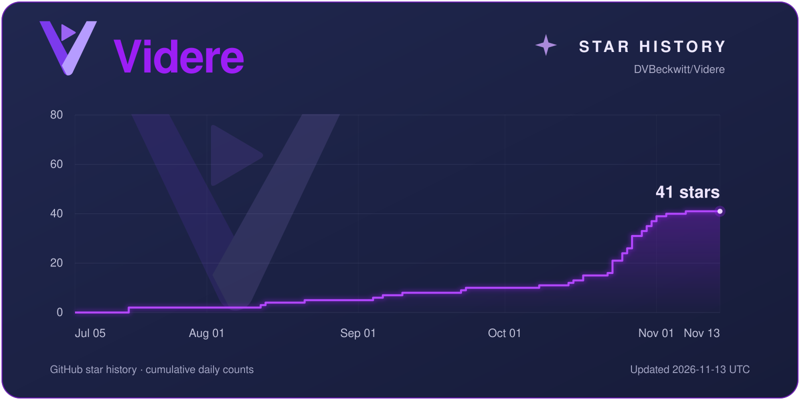
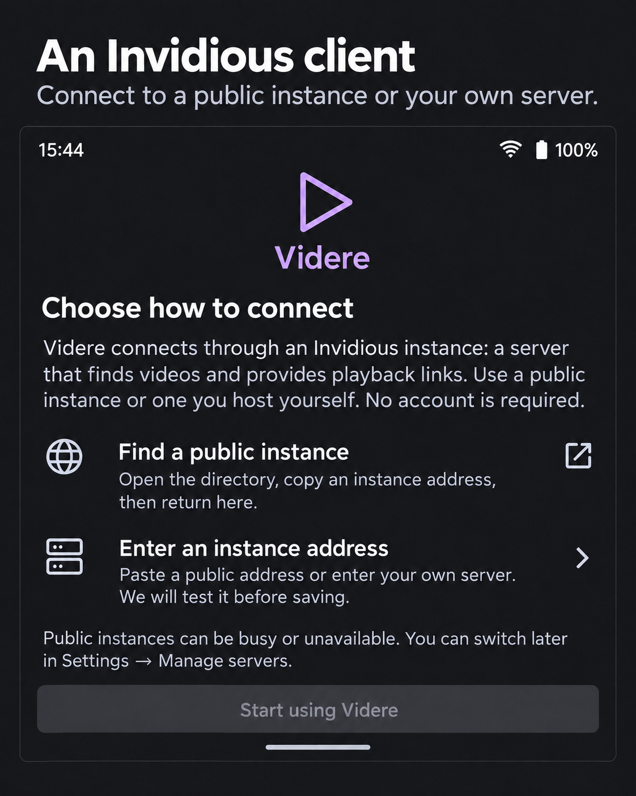
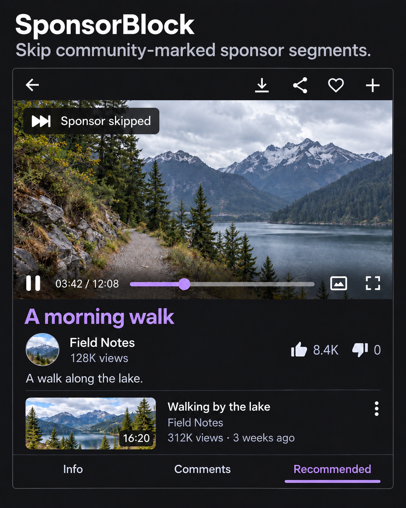
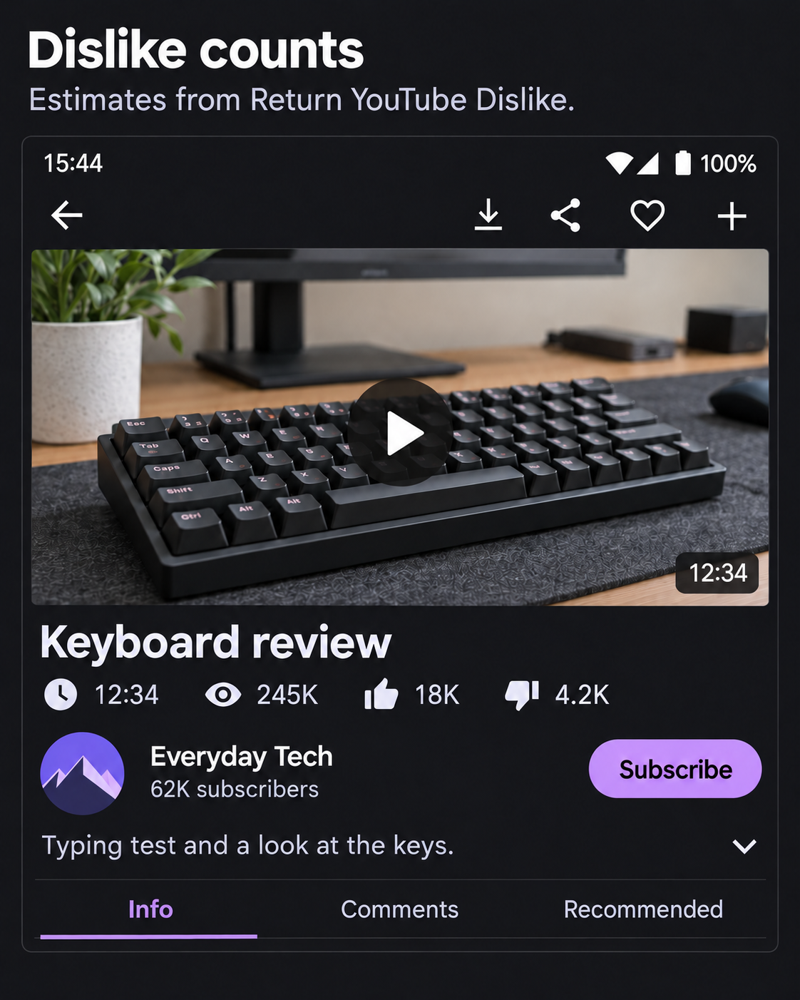
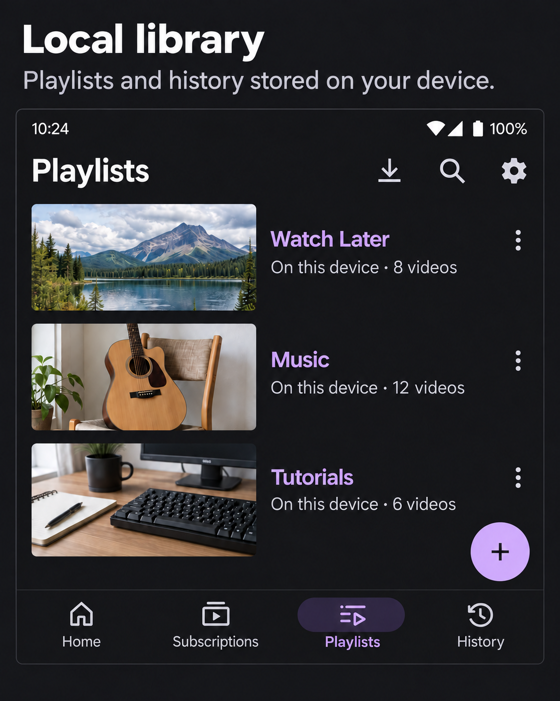
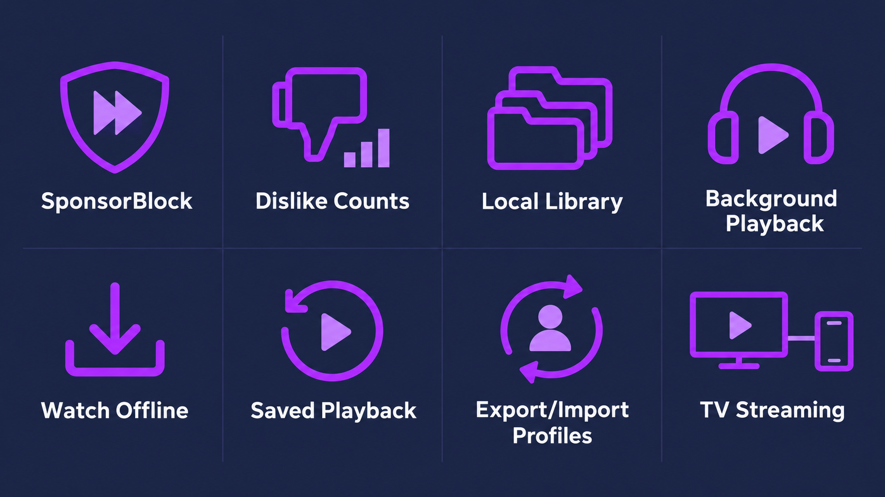

# Videre

[](./docs/star-history.md)

**An open-source [Invidious](https://invidious.io) client for Android phones, tablets, and TVs.**

Watch, listen, and download through a public Invidious instance or your own server. No Google account required; Invidious accounts are optional.

**[Download the latest APK](https://github.com/DVBeckwitt/Videre/releases/latest)** · Android 7.0+ · [Report a bug](https://github.com/DVBeckwitt/Videre/issues)

[](https://github.com/DVBeckwitt/Videre/actions/workflows/build.yml)
[](./LICENSE)

<p>
  <a href="./screenshots/videre-invidious.png"></a>
  <a href="./screenshots/videre-sponsorblock.png"></a>
  <a href="./screenshots/videre-dislikes.png"></a>
  <a href="./screenshots/videre-private-library.png"></a>
</p>

## Features



- **SponsorBlock.** Skip community-marked sponsor segments by default.
- **Dislike Counts.** Estimates from Return YouTube Dislike, enabled by default.
- **Local Library.** Save subscriptions, Watch Later, playlists, and history on your device without an account.
- **People and Accounts.** Keep separate local libraries for each person, with multiple saved accounts on the same instance.
- **Watched Status.** Mark videos watched or unwatched on phone and TV; signed-in accounts retry pending changes to server history.
- **Protected Servers.** Sign in through an Authentik gateway with an isolated browser session for each account.
- **Background Playback.** Background and audio-only listening, picture-in-picture, live streams, and a sleep timer.
- **Watch Offline.** Video, audio, and playlist downloads on phones and tablets, with pause, resume, retry, and Wi-Fi-only mode.
- **Saved Playback.** Remember playback positions when reopening videos on phone or TV.
- **Export/Import Profiles.** Back up and restore your local library and preferences as JSON, or import NewPipe subscriptions.
- **TV Streaming.** Pair Videre on your phone and TV over Wi-Fi. Send the current video and position, then control play/pause from your phone.

Also included: searchable transcripts with seek and copy, subtitles, video filters, and DeArrow.

## Start watching

1. **Install.** Download `app-release.apk` from [GitHub Releases](https://github.com/DVBeckwitt/Videre/releases/latest) and allow installation if Android asks. One APK supports phones, tablets, and TVs.
2. **Add a server.** On the Add server screen, choose **Public instances** or enter your own server address. Select **Test and add server**.
3. **Watch.** Find videos, follow channels, or save to Watch Later. No account required.

Add more addresses in **Settings → Manage servers → Add server**. Switch with **Use this server**; saved addresses and per-server logins are retained. Accounts stay with their original instance.

Open **Profiles** from the home screen or Settings to add, rename, or switch people. Your existing library becomes **Default**. Each person has separate history, resume positions, Watch Later, playlists, subscriptions, and downloads. Profiles organize a shared device; they do not require a PIN. Portable JSON backups export the current person's library without saved account credentials.

For an HTTPS instance behind Authentik, select **Sign in to protected server**, complete the gateway login, then authorize the Invidious account. This requires an Android System WebView with isolated-profile support. See [profiles, watched sync, and protected-server behavior](./docs/profiles-and-authentication.md) for migration details and limitations.

For playback problems, **Connection help** checks the video API and lets you switch instances or open the video in a browser.

This README describes the current source. Check release notes for your APK's features.

## Public instances

Suggested hosts from the [official Invidious directory](https://docs.invidious.io/instances/), with the last check date shown for each host:

| Public host | Browser | Videre | Last checked |
|---|---|---|---|
| [invidious.f5.si](https://invidious.f5.si) | ✅ Working | ✅ Working* | 9 October 2026 |
| [inv.nadeko.net](https://inv.nadeko.net) | ✅ Working | ✅ Working* | 9 October 2026 |
| [invidious.nerdvpn.de](https://invidious.nerdvpn.de) | ✅ Working | ✅ Working* | 22 October 2026 |

Choose a host in **Settings → Manage servers → Add server → Public instances**, or enter your own address. Videre tests it before saving.

\* Source checks cover search, video data, and a media sample. NerdVPN also passed server stats, direct audio, and instance-proxied video sample checks. Full Android playback is unverified; availability may change.

For self-hosting, see the [Invidious project](https://github.com/iv-org/invidious) and [installation guide](https://docs.invidious.io/installation/).

## Useful tips

**Player controls.** On phones, pull down from the top of the description or comments to minimize the player. Press Home for picture-in-picture where supported and enabled in Android settings. Closing that window keeps audio playing; use the notification to pause or stop.

**Seek previews.** Drag the phone's seek bar to see a thumbnail and target time before releasing to seek. On TV, seeking with Left/Right or the rewind/forward buttons briefly shows the target frame. Thumbnails require storyboard images from the video's Invidious server; otherwise the preview shows the time. Live streams and offline videos have no thumbnail previews.

**Video quality.** Videre remembers the quality you select for later videos, including after reopening the app. If that resolution is unavailable, it prefers the closest lower resolution, or the lowest available if all are higher. Turn this off with **Remember video quality** in **Settings → Video player** (also available in TV settings). Downloads keep their own quality selection.

**Download folder.** Choose a folder with **Settings → Download folder** or the folder button in **Downloads**. New downloads use that folder; existing files stay where they are. Videre temporarily assembles media in app storage, then saves the finished file in your chosen folder for offline playback and access from other apps. App storage remains the default. Folder permissions are device-specific and excluded from backups. If removable storage is disconnected or access is revoked, reconnect it or choose the same folder again before retrying. Deleting a download also deletes its saved file; files in a chosen folder otherwise survive uninstalling Videre.

**SOCKS5 / Orbot.** Open **Settings → Network proxy**, select **Use Orbot preset**, and start Orbot with its SOCKS listener enabled. The editable preset is `127.0.0.1:9050`; Orbot VPN mode is not required. Save proxy settings before adding your first server; once a server is selected, use **Test connection**. Applying a change stops playback and pauses unfinished downloads; resume them afterward. Saving unchanged settings does not interrupt them. Internet requests fail when the enabled proxy is unavailable. External browser sign-in uses the browser's connection; protected-server sign-in follows the configured proxy and requires WebView proxy-override support. Phone/TV remote control stays on the LAN. Native and full-app Orbot playback have been checked on a Pixel 8 Pro; public-instance video availability remains separate. See [coverage and verification limits](./docs/socks-proxy.md).

**Subscriptions.** Enable **Settings → Browsing → Hide watched subscription videos** to hide watched videos from subscription feeds, including home sections and TV. This uses the current person's watched status. Manual choices take priority; local playback counts as watched at 90% completion, and imported server history counts when no local playback state exists. Partly played videos stay visible unless manually marked watched. Turn the setting off to show everything again. When a page is entirely hidden, use **Load more** to reach older videos.

**Phone navigation.** Open the home pencil button → **Navigation**, or **Settings → Browsing → Customize app sections**. Hold and drag items to reorder them or move them between **Bottom tabs**, **Top icons**, and **Hidden**. Tap an item for move options or to choose a startup tab. Changes save automatically and are included in library backups. Keep 2–5 bottom items, including at least one main screen tab; Settings stays available. **Restore default navigation** returns to Home, Subscriptions, History, Search below and Downloads, Queue, Playlists above. Tablet and TV layouts have their own settings.

**TV history.** Open **History** in the TV sidebar. **On this device** shows locally watched videos, including saved playback progress. When signed in, **On your server** shows history from the selected Invidious account; use the same instance and account to find videos watched on another device. Server history does not include playback positions. Use **Refresh** to check for new entries. History can be hidden in the TV layout settings without changing your phone layout.

**Queue autoplay.** Use **Autoplay next in queue** in the queue screen, **Settings → Video player**, or TV settings. It is on by default. Turn it off to stop when each video ends, including in repeat mode; your queue stays available and Next or selecting a queued video still works. The setting also applies to background audio and downloads, survives restarts and backups, and is separate from autoplay when first opening a video.

**Backups.** In Settings, use **Export backup** to save your local library, filters, and preferences. Use **Restore or import subscriptions** for Videre backups or NewPipe subscriptions JSON. Preview, then merge or replace local data. Logins and downloads are excluded. Reopen Videre after restoring.

**Downloads.** Phones and tablets only. Use the Wi-Fi button for Wi-Fi-only transfers. Pause, resume, or retry individual videos; playlists download at 720p. Downloads restart if the server cannot resume. Transfers may stop while Videre is closed; reopen it to recover interrupted jobs.

**Watch Later.** Open a video's menu, choose **Add to playlist**, then **Watch Later**. On phones, open the Playlists button in the top bar to find it again. Watch Later is stored on your device and needs no account.

**Phone remote.** Open Videre on both devices on the same trusted Wi-Fi. On TV, select **Receive from phone**. On your phone, open **Send to TV / remote control**, enter the TV's IP, port, and six-digit code, then **Send current video**. Position and play/pause state transfer; control play/pause from your phone. Uses unencrypted local HTTP; no Chromecast or automatic discovery.

## Updates, migration, and privacy

**Updates.** Add `https://github.com/DVBeckwitt/Videre` to Obtainium as a GitHub source. APK updates require the same signing key. Videre is not on F-Droid, IzzyOnDroid, Accrescent, or Google Play; Clipious is a separate app.

**Moving from Clipious.** Videre (`com.github.dvbeckwitt.videre`) and Clipious (`com.github.lamarios.clipious`) install separately. Set up Videre before removing Clipious: Android does not transfer their data, and Videre cannot import Clipious app storage directly.

**Privacy.** Local and server libraries are separate. The instance operator affects privacy and reliability. YouTube avatars, banners, and video thumbnails use the selected Invidious instance's image proxy, including notification and download artwork. This is independent of the video-stream proxy and SOCKS5 settings; image failures do not retry the original Google URL. Third-party artwork such as DeArrow still uses its own service. Playback may connect directly to YouTube/Google when media proxying is off. SponsorBlock and Return YouTube Dislike contact their services directly; both default to on and can be disabled in Settings. See the [privacy policy](./docs/privacy.html).

## Contributing

Report bugs and suggestions through **Settings → Bugs and suggestions** in builds connected to the feedback service, or through [GitHub Issues](https://github.com/DVBeckwitt/Videre/issues). The in-app form supports bugs and suggestions without a GitHub account. Diagnostics and screenshots are optional and off by default. Review the public report before sending; drafts stay in app storage until you send them. Failed or unconfirmed submissions keep the same report for retry, and confirmed issue links are saved under **My reports**.

The account-free flow requires a hosted relay and a repository-scoped GitHub App. Deployment, privacy boundaries, local testing, and build configuration are documented in [services/feedback/README.md](services/feedback/README.md). An APK without a configured relay can save drafts but cannot submit them. No GitHub credentials belong in the APK.

Videre is an independently maintained [Clipious](https://github.com/lamarios/clipious) fork with transcript search, improved navigation, and local library features. Translations live in `lib/l10n/*.arb`. Keep pull requests focused; reuse existing code and remove obsolete alternatives.

<details>
<summary><strong>Build and develop</strong></summary>

Install Git, JDK 21, Android SDK 36, and an Android device or emulator. Use the pinned Flutter submodule:

```bash
git clone --recurse-submodules https://github.com/DVBeckwitt/Videre.git
cd Videre
./submodules/flutter/bin/flutter pub get
./submodules/flutter/bin/flutter run
```

For an existing clone, run `git submodule update --init`, then `./submodules/flutter/bin/flutter pub get`. On Windows, use `flutter.bat` and `dart.bat`.

Build a debug APK:

```bash
./submodules/flutter/bin/flutter build apk --debug
```

APK output: `build/app/outputs/flutter-apk/`. Package restore regenerates untracked localization files in `lib/l10n/generated/`.

Run CI's formatting, analysis, and offline tests:

```bash
./submodules/flutter/bin/dart tools/validate.dart
```

Add `format`, `analyze`, or `test` to run one stage. Windows: `./submodules/flutter/bin/dart.bat tools/validate.dart`.

The helper uses the pinned SDK and repository root, checks formatting without rewriting files, and defines the offline test targets. After editing [the helper](./tools/validate.dart), run `./submodules/flutter/bin/dart tools/validate_test.dart`.

[CI](./.github/workflows/build.yml) also runs Windows release-script safety tests and builds a profile APK on Linux; the offline helper covers neither.

Run the full suite, including live Invidious tests:

```bash
nix-shell --run './submodules/flutter/bin/flutter test'
```

This starts local Invidious with login `test` / `test`.

Code map: `lib/` by feature; `lib/utils/` for Sembast/SQLite storage; `lib/service.dart` for Invidious API calls.

</details>

<details>
<summary><strong>Signed releases on Windows</strong></summary>

[The release helper](./tools/build_android_release.ps1) installs pinned, hash-verified tools in `%USERPROFILE%\.videre-build-tools` and builds signed artifacts. Keep your existing Gradle signing-properties file outside the repository and managed build directories, then run:

```powershell
$env:ANDROID_KEY_FILE = 'C:\secure\videre\key.properties'
pwsh -NoProfile -File .\tools\build_android_release.ps1
```

`-ValidateOnly` checks paths without downloading tools or reading signing material. Run safety tests with `pwsh -NoProfile -File .\tools\build_android_release.Tests.ps1`. Other release builds also require `ANDROID_KEY_FILE` before `flutter build apk --release`.

Test APK signing-output verification with `python -m unittest discover -s tools -p test_apk_signing.py -v`. The release workflow checks the existing signing certificate across both older and current Android SDK output formats.

</details>

## Credits and license

The name Videre ("to watch") is a nod to Invidious' Latin roots.

Original Clipious code: Copyright (C) 2023 Paul Fauchon and contributors. Videre modifications: Copyright (C) 2026 DVBeckwitt and Videre contributors.

Licensed under the [GNU Affero General Public License v3.0 or later](./LICENSE), without warranty. Videre is not affiliated with Google, YouTube, Invidious, or the original Clipious maintainers. Users are responsible for the laws and terms that apply to their use of the app and their selected instance.
